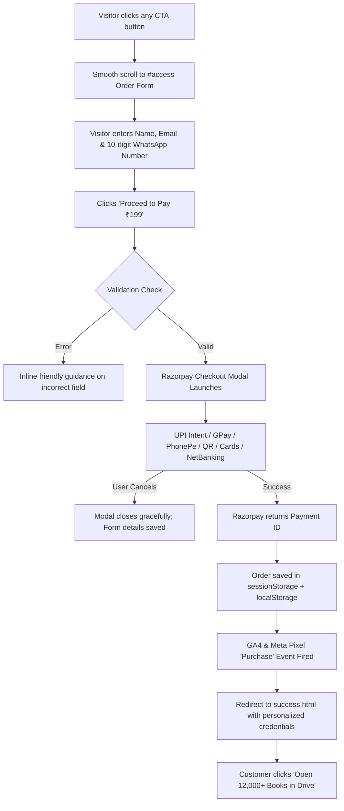

# RAZORPAY PURCHASE FLOW & INTEGRATION GUIDE
**Divy Library — 12,000+ eBook Collection**

This guide explains how the end-to-end purchase flow works, how to test it immediately, and how to activate your live Razorpay credentials.

---

## 1. How the Purchase Flow Works



---

## 2. Testing the Purchase Flow Right Now (Demo Mode)

The system includes a **built-in safe Demo Mode**:
1. Open `index.html` in your browser.
2. Click **"Claim Lifetime Access — ₹199"** or scroll to the order form.
3. Enter your Name, Email, and a 10-digit phone number.
4. Click **"Proceed to Pay ₹199"**.
5. Because the Razorpay Key in `checkout.js` is set to `rzp_live_XXXXXXXXXXXXXXXX`, the script automatically detects demo mode, simulates a secure payment verification, and routes you directly to `success.html`.
6. On `success.html`, you will see:
   - Personalized greeting (`Welcome, [Your Name]!`)
   - Simulated Payment ID (`pay_demo_...`)
   - Active Google Drive button & 1-click "Copy Link" button
   - Printable receipt view

---

## 3. Connecting Your Real Razorpay Account (2-Minute Setup)

### Step 1: Get Your Key ID
1. Log in to your [Razorpay Dashboard](https://dashboard.razorpay.com).
2. Go to **Settings** &rarr; **API Keys**.
3. Generate/Copy your **Key ID** (`rzp_live_...` for live sales, or `rzp_test_...` for test cards).

### Step 2: Paste in `checkout.js`
Open `checkout.js` and update line 22:
```javascript
const CONFIG = {
  // Replace with your actual Razorpay Key ID
  RAZORPAY_KEY: 'rzp_live_YOUR_ACTUAL_KEY_HERE',

  // Replace with your real Google Drive folder URL
  DRIVE_FOLDER_URL: 'https://drive.google.com/drive/folders/YOUR_REAL_FOLDER_ID',
  ...
};
```

---

## 4. Automating Delivery to Buyer Email & WhatsApp

When a customer pays ₹199, they immediately get the link on `success.html`. To also deliver the backup link automatically to their Email and WhatsApp:

### Option A: Using Zapier / Make.com (No-Code, 15 Minutes)
1. **Trigger:** Webhook in Razorpay.
   - Go to Razorpay Dashboard &rarr; **Settings** &rarr; **Webhooks**.
   - Add new Webhook URL (from Zapier or Make).
   - Select event: `payment.captured`.
2. **Action 1 (Email):** Gmail / SendGrid.
   - Send email to `notes.customer_email` or `email`.
   - Subject: *"Your Lifetime Access to Divy Library (12,000+ eBooks)"*.
   - Body: Send the Google Drive link and welcome instructions.
3. **Action 2 (WhatsApp - Optional):** Wati / AiSensy / QuickSend.
   - Send template message to `notes.customer_whatsapp` with the Drive link.

---

## 5. Alternative: Using Razorpay Payment Pages / Links

If you prefer using a hosted Razorpay Payment Link instead of the modal popup:
1. Create a Payment Link at [Razorpay Payment Links](https://dashboard.razorpay.com/app/payment-links) for ₹199.
2. In Razorpay settings, set the redirect URL to:
   `https://yourdomain.com/success.html`
3. In `checkout.js`, you can simply set `window.location.href = 'https://rzp.io/l/YOUR_LINK'` inside the submit handler.

---

## 6. Files Involved in the Purchase Flow

| File | Role |
|------|------|
| `index.html` | Contains the `#access` Order Form capturing Name, Email & WhatsApp. |
| `checkout.js` | Validates inputs, launches Razorpay standard checkout, saves order data, tracks events. |
| `style.css` | High-contrast, mobile-responsive styling for the order terminal, inputs, and payment badges. |
| `success.html` | Post-purchase portal displaying receipt, 1-click Google Drive launcher, copy button, and WhatsApp support. |
